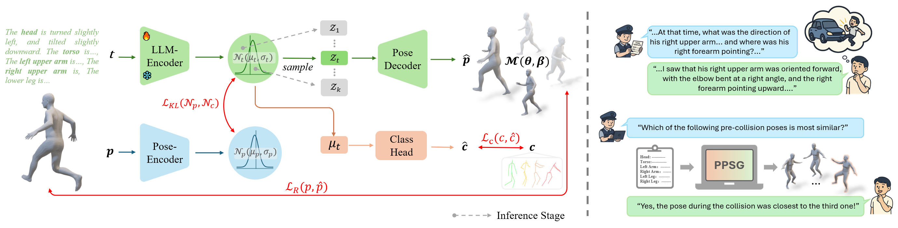
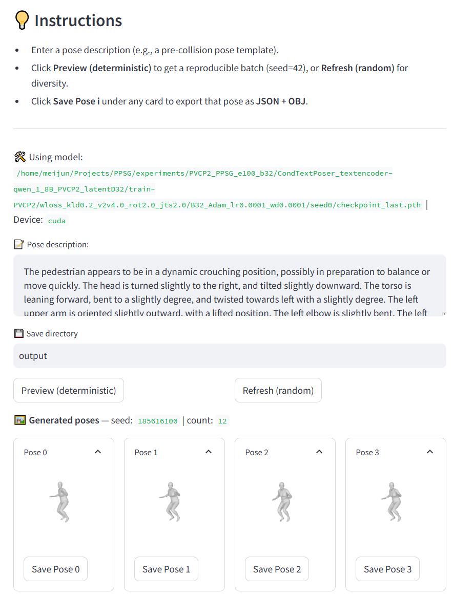

### **PPSG: Pedestrian Pre-Collision Pose Generation from Non-Visual Eyewitness Descriptions**

[English] | [简体中文](README_CN.md)

📣 Our work is currently under journal review…

---


### 1. Environment Setup

Our codebase and environment are inherited from the [PoseScript](https://github.com/naver/posescript/tree/posescript) project. You may configure your environment following PoseScript as well.

Environment requirements: `python 3.8`; `torch 1.13.0+cu116`; `requirements.txt`

```bash
conda create -n PPSG_env python=3.8
conda activate PPSG_env

pip install -r requirements.txt
python setup.py develop
````

<details>
<summary><strong>📂 Project Directory Structure</strong> (Click to expand/collapse)</summary>

```bash
PPSG
├── data
│   ├── PVCP2
│   └── smpl_body_models
│       ├── SMPL_NEUTRAL.pkl
│       └── SMPL_N_model.npz
├── experiments
│   └── PVCP2_PPSG_e100_b32
│       └── checkpoint_last.pth
├── pretrainllm
│   └── Qwen
│       └── Qwen-1_8B
├── IMAGE
├── LICENSE
├── README.md
├── requirements.txt
├── setup.py
└── src
```

</details>

---

### 2. Download Required Data and Models

* **[PVCP2 Dataset](https://github.com/wmj142326/PVCP2)**: Download PVCP2 and put it under `./data/PVCP2/`.

* **[SMPL Models](https://huggingface.co/lithiumice/models_hub/tree/main)**: Download the following SMPL model files  
  and place them in `./data/smpl_body_models/`:

  * `SMPL_NEUTRAL.pkl`
  * `SMPL_N_model.npz`

* **[Training Checkpoints](https://pan.baidu.com/s/1W4m3ENNvjo2brovYThFbKQ?pwd=j14w)**
  Download our trained checkpoints and place them under `./experiments/`:

* **[QWen1.8B Model](https://huggingface.co/Qwen/Qwen-1_8B)**
  Download from HuggingFace and store under `./data/pretrainllm/Qwen/`
  You may also use `modelscope`:

  ```bash
  modelscope download --model Qwen/Qwen-1_8B --local_dir ./Qwen/Qwen-1_8B
  ```

* Modify the paths in `./src/text2pose/config.py`:

  ```bash
  ### Data
  GENERAL_EXP_OUTPUT_DIR = MAIN_DIR + '/experiments'
  PRETRAIN_LLM_MODEL_DIR = MAIN_DIR + '/pretrainllm'
  PVCP2_LOCATION = MAIN_DIR + '/data/PVCP2'

  ### SMPL pose config
  SMPL_BODY_MODEL_PATH = MAIN_DIR + '/data/smpl_body_models'
  SMPL_NEUTRAL_BM = f'{SMPL_BODY_MODEL_PATH}/SMPL_N_model.npz'
  SMPL_n_betas = 10
  SMPL_NB_INPUT_JOINTS = 24
  ```

---

### 3. Training and Evaluation

1. Modify parameters in `src/text2pose/generative/script_generative.sh` if needed. Default parameters:

   ```bash
   # global/default configuration
   args=(
       --model 'CondTextPoser'
       --text_encoder_name 'qwen_1_8B_PVCP2'
       --dataset 'PVCP2'
       --latentD 32
       --wloss_v2v 4 --wloss_rot 2 --wloss_jts 2
       --wloss_kld 0.2
       --wloss_cls 0.01
       --lr 0.0001 --wd 0.0001
       --batch_size 32
       --saving_ckpt_step 
       --log_step 50
       --epochs 100
       --fid 'PVCP2'
       --seed ${run_id_seed}
       --subdir ${sub}
   )
   ```

2. Run Training + Evaluation:

   ```bash
   cd src/text2pose

   bash generative/script_generative.sh -a train-eval -s 0 -z PVCP2_PPSG_e100_b32
   ```

---

### 4. Inference & Demo

1. Launch the demo UI:

   ```bash
   cd src/text2pose

   streamlit run generative/demo_generative.py -- --model_path [$model_dir/*.pth]
   ```

2. Use example text input format in the [PVCP2](https://github.com/wmj142326/PVCP2) dataset.
   <details>
    <summary>Test Example 1: Frame_001003.png (Click to expand)</summary>

   The pedestrian appears to be in a dynamic crouching position, possibly preparing to balance or move quickly. The head is turned slightly to the right and tilted downward. The torso leans forward and is slightly twisted to the left. The arms are positioned outward with elbows slightly bent, palms facing downward. The left leg is bent with the foot off the ground, while the right leg supports the body with the foot fully touching the ground.

    </details>

    <details>
    <summary>Test Example 2: Frame_024673.png (Click to expand)</summary>

   The pedestrian stands in a wide evasive stance with both arms stretched outward. The torso leans slightly forward. Both legs are slightly bent outward, with feet not fully touching the ground, suggesting a defensive or preparatory posture.

    </details>
   

3. UI Demo (Our online demo will be available soon...)

    