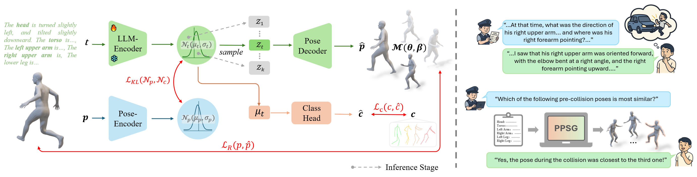
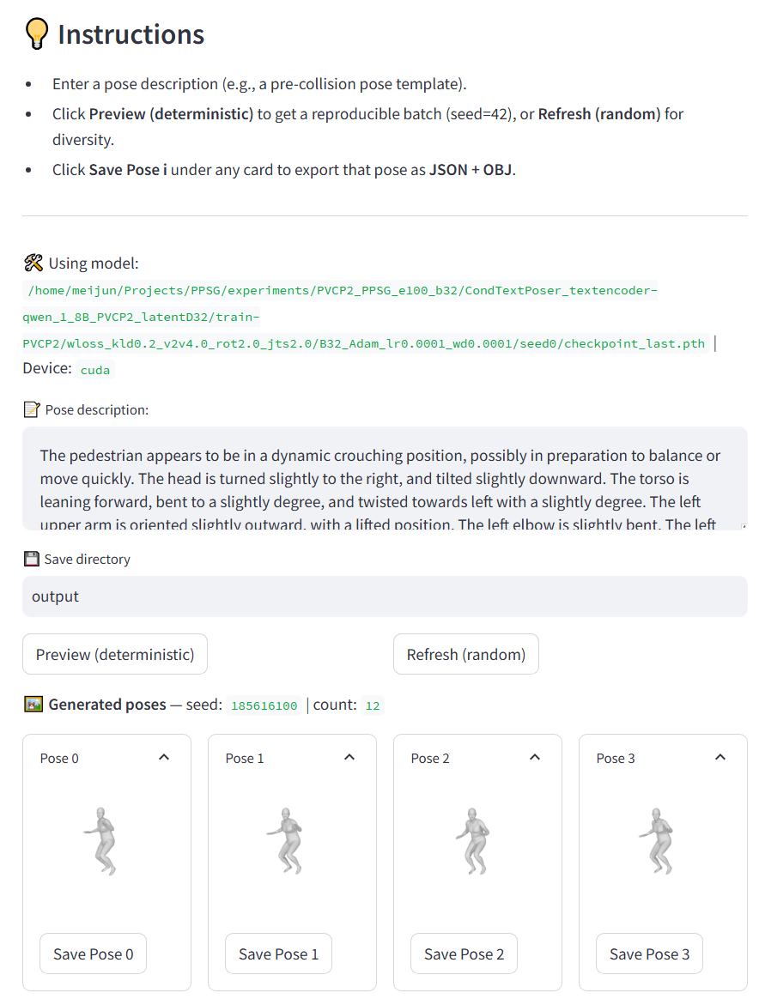

# README

### Pedestrian Pre-Collision Pose Generation from Eyewitness Descriptions Without Visual Evidence**

[English](README.md) | 简体中文

📣 Our work is currently in the journal submission stage…

---


### 1. 安装环境

我们的代码和环境和继承自[PoseScript](https://github.com/naver/posescript/tree/posescript)项目，您也可以根据该项目配置环境。 环境配置:`python 3.8`; `1.13.0+cu116`; `requirements.txt` 

```python
conda create -n PPSG_env python=3.8
conda activate PPSG_env

pip install -r requirements.txt
python setup.py develop
```

<details>
<summary><strong>📂 项目目录结构</strong>（点击展开/收起）</summary>

```bash
PPSG
├── data
│   ├── PVCP2
│   └── smpl_body_models
│       ├── SMPL_NEUTRAL.pkl
│       └── SMPL_N_model.npz
├── experiments
│   └── PVCP2_PPSG_e100_b32
│       └── checkpoint_last.pth
├── pretrainllm
│   └── Qwen
│       └── Qwen-1_8B
├── IMAGE
├── LICENSE
├── README.md
├── requirements.txt
├── setup.py
└── src
```
</details> 

    

### 2. 下载数据

- [PVCP2](https://drive.google.com/drive/folders/1z-qndztHsL2Xa0DB9aZSGigwok87Fk0m?usp=drive_link)数据集：下载PVCP2数据集至路径 `./data/PVCP2/` 路径下。(见[PVCP2](https://github.com/wmj142326/PVCP2)项目)
- [SMPL](https://huggingface.co/lithiumice/models_hub/tree/main)模型文件：下载SMPL模型: [SMPL_NEUTRAL.pkl](https://huggingface.co/lithiumice/models_hub/tree/main/4_SMPLhub/SMPL/X_pkl) 和 [SMPL_N_model.npz](https://huggingface.co/lithiumice/models_hub/tree/main/4_SMPLhub/SMPL/X_model_npz) 放入`./data/smpl_body_models/`路径下。
- [训练权重](https://drive.google.com/drive/folders/1z-qndztHsL2Xa0DB9aZSGigwok87Fk0m?usp=drive_link)：下载我们的训练模型权重至`./experiments/`文件夹下。
- [QWen1.8B](https://huggingface.co/Qwen/Qwen-1_8B)：将QWen1.8B模型放入`./data/pretrainllm/Qwen/` 路径下，使用以下命令下载：
    
    ```bash
    modelscope download --model Qwen/Qwen-1_8B --local_dir ./Qwen/Qwen-1_8B
    ```
    
- 修改`./src/text2pose/config.py`以下路径参数：
    
    ```bash
    ### Data
    GENERAL_EXP_OUTPUT_DIR = MAIN_DIR + '/experiments' # where models will be saved (along with logs, generated poses...)
    PRETRAIN_LLM_MODEL_DIR = MAIN_DIR + '/pretrainllm' # LLM models will be saved
    PVCP2_LOCATION = MAIN_DIR + '/data/PVCP2' # where PVCP2 is located .
    
    ### SMPL pose config
    SMPL_BODY_MODEL_PATH = MAIN_DIR + '/data/smpl_body_models'  # where SMPL body models are located.
    SMPL_NEUTRAL_BM = f'{SMPL_BODY_MODEL_PATH}/SMPL_N_model.npz'
    SMPL_n_betas = 10
    SMPL_NB_INPUT_JOINTS = 24
    ```
    

### 3. 训练和验证

1. 按照需求修改`src/text2pose/generative/script_generative.sh`，以下是默认参数
    
    ```bash
    # global/default configuration
    args=(
        --model 'CondTextPoser'
        --text_encoder_name 'qwen_1_8B_PVCP2'
        --dataset 'PVCP2' #
        --latentD 32
        --wloss_v2v 4 --wloss_rot 2 --wloss_jts 2
        --wloss_kld 0.2
        --wloss_cls 0.01
        --lr 0.0001 --wd 0.0001
        --batch_size 32
        --saving_ckpt_step 
        --log_step 50
        --epochs 100
        --fid 'PVCP2'
        --seed ${run_id_seed}
        --subdir ${sub}
    )
    ```
    
2. 运行
    
    ```bash
    cd src/text2pose
    
    bash generative/script_generative.sh -a train-eval -s 0 -z PVCP2_PPSG_e100_b32
    ```
    

### 4. 推理

1. 运行以下命令：
    
    ```bash
    cd src/text2pose
    
    streamlit run generative/demo_generative.py -- --model_path [$model_dir *.pth$]
    ```
    
2. . 参考[PVCP2](https://github.com/wmj142326/PVCP2)数据集项目获取输入推理输入。

    <details>
    <summary>测试示例 1：Frame_001003.png (点击展开)</summary>
    <div style="border:1px solid #ddd; border-radius:8px; padding:12px; background:#fafafa;">
    The pedestrian appears to be in a dynamic crouching position, possibly in preparation to balance or move quickly. The head is turned slightly to the right, and tilted slightly downward. The torso is leaning forward, bent to a slightly degree, and twisted towards left with a slightly degree. The left upper arm is oriented slightly outward, with a lifted position. The left elbow is slightly bent. The left forearm is pointing forward, and the palm is facing downward. The right upper arm is oriented slightly outward. The right elbow is slightly bent, positioned slightly below and behind the left elbow. The right forearm is pointing forward, and the palm is facing downward. The left thigh is oriented to the side and slightly forward, relative to the torso's forward axis. This indicates a balancing motion. The left knee is significantly bent. The lower leg is pointing downward. The sole of the foot is not touching the ground, and the toes are pointing downward. The right thigh is oriented forward, relative to the torso's forward axis, indicating a supportive stance. The right knee is positioned moderately forward and above the left knee, and is significantly bent. The lower leg is pointing downward and backward. The sole of the foot is fully touching the ground, and the toes are pointing. 
    </div>
    </details>


    <details>
    <summary>测试示例 2：Frame_024673.png (点击展开)</summary>
    <div style="border:1px solid #ddd; border-radius:8px; padding:12px; background:#fafafa;">
    The pedestrian is in an evasive wide-legged stance with arms stretched outward, suggesting a preparatory or defensive action. The head is turned straight and tilted slightly downward. The torso is leaning slightly forward, bent to a slightly degree, and twisted towards none with a not degree. The left upper arm is oriented straight outward, with a stretched position. The left elbow is not bent. The left forearm is pointing outward, and the palm is facing downward. The right upper arm is oriented straight outward. The right elbow is not bent,positioned level with the left elbow. The right forearm is pointing outward, and the palm is facing downward. The left thigh is oriented outward and downward, relative to the torso's forward axis. This indicates a posed stance. The left knee is slightly bent. The lower leg is pointing outward. The sole of the foot is not touching the ground, and the toes are pointing slightly upward. The right thigh is oriented outward and downward, relative to the torso's forward axis, indicating a posed stance. The right knee is positioned level with the left knee, and is slightly bent. The lower leg is pointing outward. The sole of the foot is not touching the ground, and the toes are pointing slightly upward. 
    </div>
    </details>

3. UI界面

    <!--  -->
    
